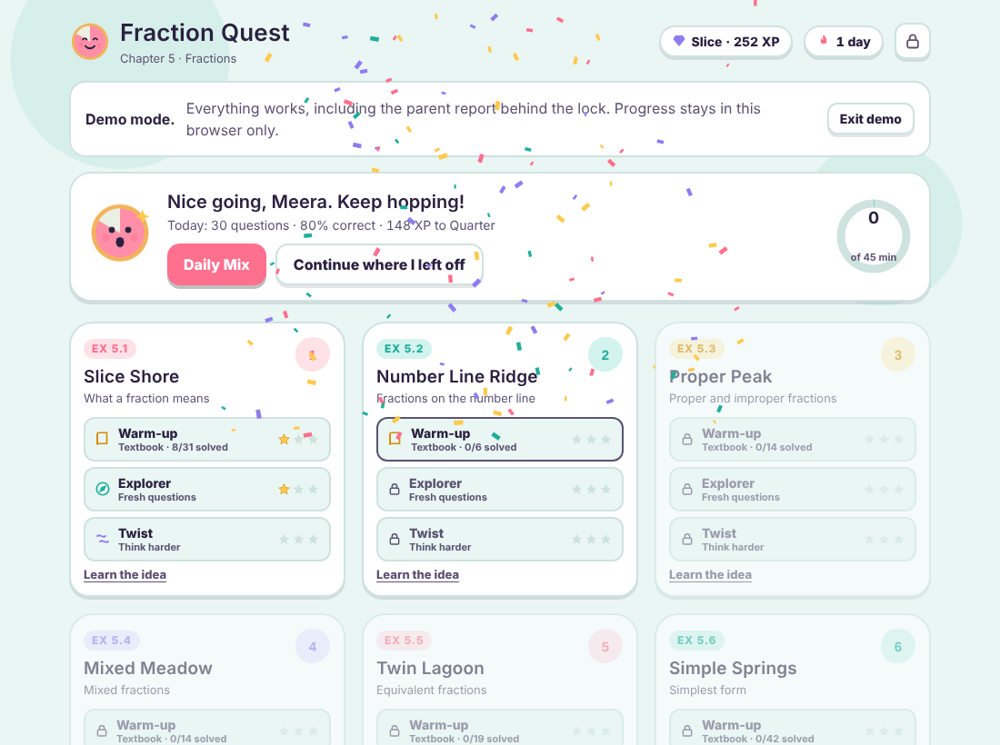
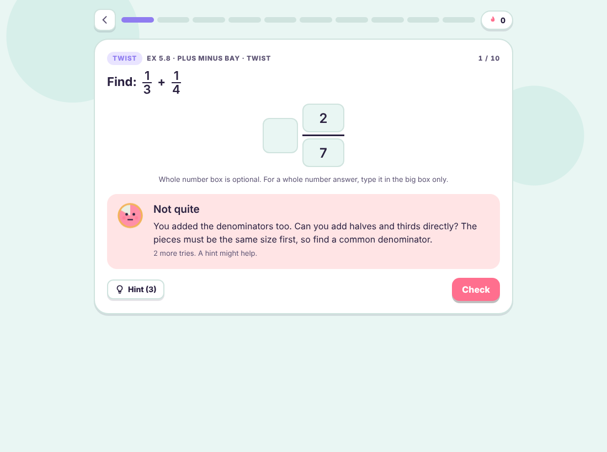
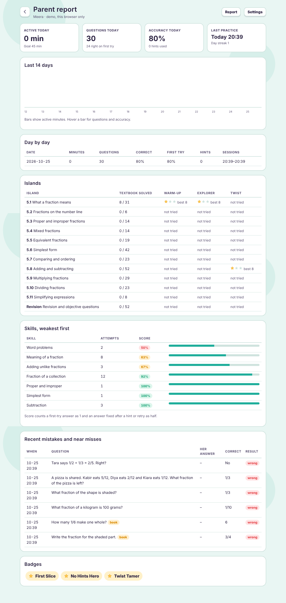
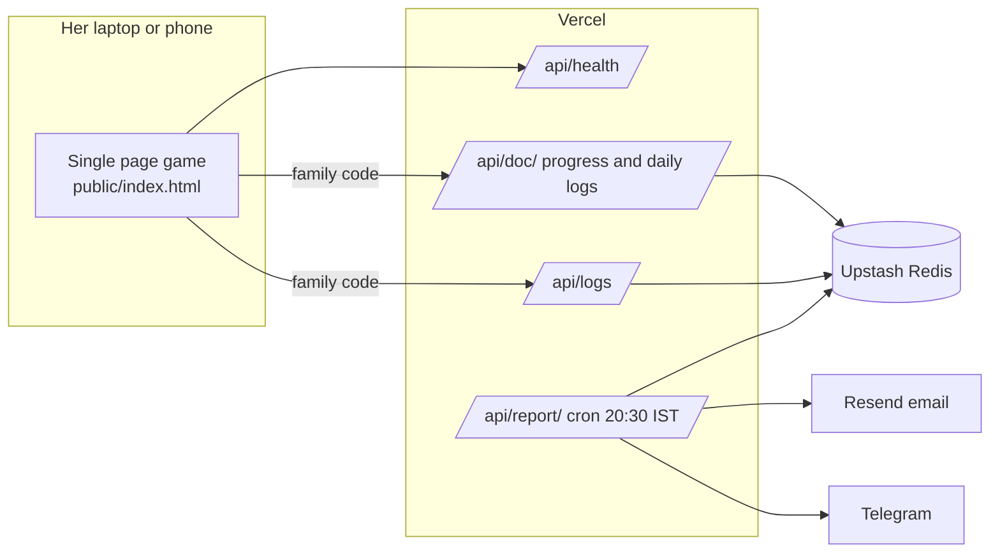

# Fraction Quest

A fractions practice game I built for my daughter's Class 6 (ICSE) maths chapter. It turns all 25 pages of the chapter into twelve islands, and it teaches by making her think from first principles instead of repeating a procedure. A parent report and an evening email show me whether she actually practised and where she struggled.



## The problem

Textbook exercises train procedures. My daughter could add fractions when the question looked like the book, but a small twist ("subtract A from B", "what must be added to get 1", "is this answer even sensible?") threw her. Her notebook also showed a habit of stopping before simplifying (writing 12/4 instead of 3). I wanted daily practice that keeps the textbook as a warm up, then pushes past it, and tells me honestly how it went.

## How it teaches

| Level | What it does |
|---|---|
| Warm-up | Every question from Exercises 5.1 to 5.11 plus the revision and objective sections: 313 in total. Answers are computed by an exact fraction engine, never typed by hand. |
| Explorer | Fresh questions from generators, new numbers every round, so answers cannot be memorised. |
| Twist | Reverse questions, spot the error, estimate before solving, wording traps, open questions with many right answers, plus review questions from earlier islands. |

Other things that matter for learning:

* **Mistake detection.** The engine works out the common wrong answers for each question and explains the specific misconception: adding denominators, flipping the wrong fraction when dividing, multiplying the parts of mixed numbers separately, subtracting in the wrong order.

  

* **Simplification habit.** A correct value that is not simplified is not marked wrong. The game says "Right value! One more step" and asks her to finish it.
* **Hints before answers.** Hints ask a guiding question first. After three wrong tries the full worked solution appears, step by step, generated from the same engine.
* **Spaced retry.** A question she got wrong comes back in a later round, and the Daily Mix weights the islands where her skills are weakest.
* **Learn cards** explain each idea with a picture before practice.

## Parent reporting

* **Live report** behind a PIN: active minutes per day, questions, accuracy, first try rate, hints, session times, stars per island, weakest skills, and her actual wrong answers next to the correct ones.
* **Evening email or Telegram** sent by a Vercel cron job, with a seven day trend and one suggestion for tomorrow.



## Architecture



* The game is one self contained HTML file with no framework and no build dependencies. The source lives in `src/` and `scripts/build.js` bundles it.
* The same file runs in four modes: on the family server (Vercel), as a public **demo** that keeps progress in the browser only, opened directly as a local file, or as a Claude artifact.
* The API is four small serverless functions with no npm dependencies. Storage is Upstash Redis over its REST API.
* Access is a shared family code checked in constant time, with brute force protection (20 wrong tries per address per hour). A separate PIN protects the parent report.

## Testing

I learned the hard way that "every answer is accepted" is not the same as "the screen is right": an early version drew blank figures while all answer tests passed. The suite now checks both.

| Suite | What it proves |
|---|---|
| `npm test` (13 server tests) | API: auth, path validation, round trips, log ordering, rate limiting, report content, email and Telegram delivery, refusing to run without storage in production. Uses a fake Upstash server. |
| Web end to end (26 checks) | Through a local server running the real handlers: family code gate, playing, sync from laptop to phone and back, parent report on a phone, demo mode never touching family data, the test report button, stale codes sent back to the gate. |
| Merge tests (3 tests) | Two devices saving at once keep every question, add up their time, and never lose the PIN, XP, stars or badges. |
| Phone typing (7 checks) | Answers typed the way phone keyboards send them, where "1/4" arrives as plain text with no key events, still split into the right boxes. Found on the live site, not in the lab. |
| Game regression | A headless browser plays 1,440 questions across every island and level through the real interface and confirms each correct answer is accepted. |
| Figure check | Counts the shaded parts actually drawn on screen for every figure question. |
| Phone check | Every question layout at phone width, with no sideways scrolling. |

```bash
npm test            # server tests
npm run test:e2e    # browser tests (needs Playwright with Chromium)
npm run dev         # local server at http://localhost:3000, family code "dev"
```

## Deploying your own copy

1. Import this repo into Vercel. The build command and output folder come from `vercel.json`.
2. In the project, open **Storage**, add **Upstash for Redis** from the Marketplace and connect it. That sets `KV_REST_API_URL` and `KV_REST_API_TOKEN`.
3. Add environment variables:

| Variable | Purpose |
|---|---|
| `FAMILY_CODE` | The code your child types once on each device. Use a passphrase, not a short number. |
| `CRON_SECRET` | Any long random string. Vercel sends it to the report cron job. |
| `RESEND_API_KEY`, `REPORT_EMAIL` | Evening email through Resend. Without your own domain, Resend only delivers to the email you signed up with. |
| `REPORT_FROM` | Optional sender, defaults to `Fraction Quest <onboarding@resend.dev>`. |
| `TELEGRAM_BOT_TOKEN`, `TELEGRAM_CHAT_ID` | Optional Telegram report. |

4. Redeploy, open the site, enter the family code, and use **Parent area → Settings → Send today's report now** to check delivery.

On the Vercel Hobby plan the cron job runs once a day at some point within the scheduled hour (8:30 to 9:30 PM IST).

## Built with

Claude (Anthropic) as my pair programmer, from reading the scanned chapter to tests and deployment. Plain JavaScript, Vercel serverless functions, Upstash Redis, Resend, Playwright.
